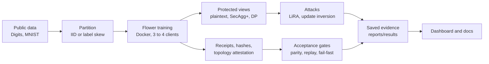

# FedDisclosure Lab

[](https://github.com/ahmedjawedaj/feddisclosure-lab/actions/workflows/ci.yml)
[](https://github.com/ahmedjawedaj/feddisclosure-lab/actions/workflows/codeql.yml)
[](LICENSE)
[](pyproject.toml)
[](#status-and-honest-limits)

**A reproducible laboratory for measuring how much a federated learning system actually discloses, and how much common defenses really help.**

FedDisclosure Lab trains real federated models with [Flower](https://flower.ai) in Docker, applies real privacy mechanisms ([Opacus](https://opacus.ai) DP-SGD, [OpenDP](https://opendp.org) releases, Flower SecAgg+), and then attacks the result with membership inference and update inversion. Every claim is tied to saved evidence, and negative results are kept next to the positive ones. Release 0.15.0 adds a proof and property tests for one SecAgg+ round, a DP bound against an informed attacker, a wire-level check on a deployed stack, a seeded-fault matrix, external baselines, a reply-order study and a scaling study. Five of its pre-registered predictions failed and are listed below.

> **This is a research benchmark, not a privacy product.** It makes no formal security or privacy certification claim. Read [Status and honest limits](#status-and-honest-limits) before you cite or reuse any number.

## Why this exists

Federated learning is often described as private because raw data never leaves the client. The literature and our own measurements say that is not enough. Updates leak, secure aggregation has failure modes, and differential privacy trades away accuracy that some clients pay for more than others. This repo asks narrow, testable questions and refuses to round the answers in anyone's favor.

## What you can do with it

| Area | What is implemented | Where |
|---|---|---|
| Native federated training | Flower 1.27 Deployment Runtime in Docker Compose (SuperLink, SuperNodes, isolated client containers) on 3 and 4 clients, plus two 8-client rounds for memory, with per-client execution receipts and a fail-fast watchdog | `compose.flower*.yaml`, `scripts/run_flower_docker.py` |
| Secure aggregation | Upstream Flower SecAgg+ runs, a dropout matrix, an error-propagation study and a multi-round acceptance rule | `scripts/run_secagg_*`, `scripts/verify_secagg_dropout_matrix.py` |
| Proofs and property tests | A proven one-round SecAgg+ quantisation error bound with property tests, and an L2 bound for convex losses over two rounds | [`docs/proofs/`](docs/proofs/one-round-secagg-error.md) |
| Differential privacy | Opacus DP-FedAvg with an RDP accountant, OpenDP counting releases with a persistent budget ledger, and a closed-form bound checked against an informed attacker for one step | `src/feddisclosure/defenses/`, [`docs/v0.15-dp-informed-attack.md`](docs/v0.15-dp-informed-attack.md) |
| Membership inference | LiRA shadow-model attack, 64 shadows and 16 targets, on Digits and full MNIST | `scripts/run_lira_study.py` |
| Update inversion | Gradient-matching reconstruction against plaintext, SecAgg+ aggregate, n-1 collusion and DP views in an observation model. The plaintext view, the aggregate view and one masked vector were also attacked on captured traffic from a 4-client, one-round Flower stack | `src/feddisclosure/attacks/view_study.py`, `scripts/run_view_comparison.py`, [`docs/v0.15-wire-validation.md`](docs/v0.15-wire-validation.md) |
| External baselines | The repository's inversion attack and LiRA compared with `breaching` and `mialibrary` on matched setups | [`docs/v0.15-external-baselines.md`](docs/v0.15-external-baselines.md) |
| Fault matrix | Five seeded faults (wrong DP noise, skipped clipping, plaintext fallback, wrong dropout handling, stale model) and the detectors that do or do not catch them | [`docs/v0.15-fault-matrix.md`](docs/v0.15-fault-matrix.md) |
| Determinism gates | Bitwise float32 replay of Flower aggregation, a strict float64 parity gate (kept strict even where it fails) and an opt-in `DeterministicFedAvg` | `scripts/reproduce_flower_bitwise.py`, [`docs/v0.15-reply-order.md`](docs/v0.15-reply-order.md) |
| Federated analytics | Three-site gateway with disclosure controls and a persistent principal-wide query history policy | `services/`, `src/feddisclosure/analytics/` |
| Evidence dashboard | Offline HTML explorer that reads only allowlisted scalar summaries | `dashboard/` |

Only synthetic or public data are used: scikit-learn Digits, plus optional Fashion-MNIST and optional MNIST, which are loaded at run time and never redistributed. See [`docs/data-provenance.md`](docs/data-provenance.md).

## Measured privacy of Flower's DP mechanisms (v0.16.0)

`scripts/audit_flower_dp.py` runs Flower's own differential privacy classes in process and compares the Gaussian mechanism that executes with the one implied by the configured parameters. Predictions were written in [`docs/preregistration/v0.16-p1.md`](docs/preregistration/v0.16-p1.md) before any run. Full tables and limits are in [`docs/v0.16-p1-flower-dp-audit.md`](docs/v0.16-p1-flower-dp-audit.md). The numbers are the same on `flwr` 1.27.0 and 1.44.0.

Read these as measurements under the stated configurations. Flower's how-to guide labels differential privacy as a preview feature, and Flower logs a warning in the second configuration below. `flwr` 1.44.0 has an optional accountant on the Message API fixed clipping strategies. With it enabled the first configuration below raises an error and the second releases nothing.

- With equal client weights and all sampled clients responding, the fixed clipping strategies deliver the configured noise multiplier. One round at multiplier 1 is epsilon 4.38 at delta 1e-5.
- With one client holding a 0.91 weight share the exact value is epsilon 79.4, and with `num_sampled_clients` set to 10 while 2 results are aggregated it is epsilon 33.1. A reported client failure does not lead to the second case, because the wrapper then releases nothing. Empirical 95% lower bounds are 10.90 and 10.49.
- With adaptive clipping and every client clipped, the update noise scale is 0.903 of the reference algorithm at the default learning rate and 0.607 at learning rate 1.0. The direction of the clip update was measured later, in the v0.16.3 section below.
- `LocalDpMod` meets its configured (epsilon, delta) for epsilon up to 5 on the tested grid. At configured epsilon 20 the exact delta is 153 times the configured delta.

## Measured adaptive clipping in Flower against the paper (v0.16.3)

`scripts/audit_flower_adaptive_clipping.py` runs the four adaptive clipping strategy classes of `flwr` (server side and client side, in the legacy and the Message API) with fake client replies and compares them with Andrew et al. (2021), arXiv 1905.03871. Predictions were written in [`docs/preregistration/v0.16-adaptive-clipping.md`](docs/preregistration/v0.16-adaptive-clipping.md) before the harness existed. It was run on `flwr` 1.27.0 and 1.44.0. All 82 rows per version held their predictions, so the findings below are about differences from the paper's reading and not about failed predictions. Tables and limits are in [`docs/v0.16-adaptive-clipping-audit.md`](docs/v0.16-adaptive-clipping-audit.md).

- The noise budget split, the default count noise and the standard deviation of the noisy count (sigma_b divided by the number of replies) follow the paper.
- The bit that feeds the clip update is set when an update is clipped, while the paper sets it when an update is not clipped. With the update rule unchanged the clip moves the other way. When all updates are clipped, the clip after one round is 0.0904837 from a start of 0.1, where the paper reading gives 0.1105171. After 23 such rounds it is 0.010026, where the paper reading gives 0.9974.
- With fixed update norms between 0.5 and 1.5, 200 rounds take a clip that starts at 0.1 to 2.06e-10 and a clip that starts at 10 to 4.85e9, so the clip moves away from the target quantile instead of settling.
- The model noise is scaled with the clip after the round's update, in all four variants. In the measured configuration the noise standard deviation is 1.0014 by the new clip and 0.6092 by the old clip, and the paper's Algorithm 1 as read once uses the old clip.
- When fewer clients reply than `num_sampled_clients`, the noise scale uses `num_sampled_clients` and the fraction uses the reply count. Flower logs a warning.

These are measurements on synthetic updates. The privacy guarantee of the whole mechanism was not measured, and no epsilon is reported. The paper's ordering was read from one summarising fetch of a web copy and not checked against the PDF.

## Measured privacy of FedML's DP mechanisms (v0.16.2)

`scripts/audit_fedml_dp.py` calls the classes under `fedml/core/dp` of `fedml` 0.9.6 directly, with placeholder modules standing in for the rest of the package, and compares the mechanism that executes with the one implied by the configured parameters. FedML's own `__init__` was never executed. Predictions were written in [`docs/preregistration/v0.16-fedml.md`](docs/preregistration/v0.16-fedml.md) before any run. 130 checks were built from them (18 were added after the first quick run, and both failed checks were in the original set), 128 held and 2 did not (both concern the error an accountant path raises). Some rows were partly confirmatory, as the pre-registration states. Only 0.9.6 was run. Tables and limits are in [`docs/v0.16-fedml-dp-audit.md`](docs/v0.16-fedml-dp-audit.md). The DP source files are byte-identical in the seven earlier releases that were compared.

Read these as measurements under the stated configurations and not as statements about intended use. FedML ships no documentation text for these parameters in the wheel, so "claimed" means the reading implied by the class docstrings and the cited papers.

- The Gaussian and Laplace mechanisms deliver the noise scale their formulas give, within 0.5% in all 18 cells measured.
- `sensitivity` is one argument for both mechanisms. With an update of L2 norm 1 spread over 16 coordinates and `sensitivity` set to 1, the executed Laplace mechanism is epsilon 4.00 where the configuration implies 1.00. The Laplace class is correct for an L1 bound, so this is a configuration note and not a property of the mechanism.
- `LocalDP` adds noise that does not depend on the input and does no clipping. With `sensitivity` 2, epsilon 1 and an update of norm 25 the exact epsilon is 34.5, and the empirical 95% lower bound is 10.57. The norm 25 update is a deliberately large toy case and `sensitivity` 2 does not bound it. Real update norms were not measured.
- The RDP to (epsilon, delta) conversion for one full step at noise multiplier 1 gives epsilon 4.73 where the exact Gaussian value is 4.38, a valid upper bound 8% above exact. Separately, `get_epsilon` raises after the first step in the three configurations tried, so this function is reached only by calling it through the class.

## Stronger inversion attack on CIFAR-10 (v0.16.1)

`scripts/p3_breaching_cifar10.py` runs the gradient inversion attack of the `breaching` library (version 0.1.2, 4,000 iterations) on real CIFAR-10 against a small CNN with 25,578 parameters. Four clients hold 8 records each and take one SGD step. The rules were committed in [`docs/preregistration/v0.16-p3.md`](docs/preregistration/v0.16-p3.md) before the script and before any run. Results are from 20 evaluation seeds on a Colab T4. The unit is the seed, and the gain is the PSNR difference to a label-only floor (class average images) with a 95% bootstrap interval. Tables, deviations and limits are in [`docs/v0.16-p3-breaching-results.md`](docs/v0.16-p3-breaching-results.md).

- The control passed. With a batch of 1 the attack gains +5.50 dB over the floor (interval +4.71 to +6.31), so the setup works when the problem is easy.
- With a batch of 8 the attack did not beat the floor. The gain is -0.12 dB in the plaintext view (interval -0.72 to +0.42) and -0.01 dB with n-1 collusion (interval -0.64 to +0.56). The pre-registered predictions R1, R3 and O1 failed and are kept as written.
- The aggregate view is 1.47 dB below the floor (interval -1.83 to -1.13), so its pass (R2) is vacuous. Plaintext is itself at the floor, so a gain over the floor cannot be used here to say what the aggregate view leaks, and this result is not evidence of privacy.
- The repository's own attack is weaker than `breaching` in every view. Its mean squared error is 2.59 times larger in the plaintext view, so B1c fails.
- SSIM gain is positive for plaintext and collusion and near zero for the aggregate. That reading was not pre-registered and needs its own rule before it is relied on.

Tuning chose the edge of the total variation grid for `breaching`, and the model, the batch size and the number of local steps were fixed. These are limits of this study and not statements about the library.

## Headline results (v0.15.0)

Current release: 0.16.3. Release 0.16.3 adds the adaptive clipping measurement described above and corrects two sentences about adaptive clipping in the v0.16.0 Flower document. It changes no result number. Release 0.16.2 adds the FedML DP measurement described above. Release 0.16.1 added the CIFAR-10 inversion study and changed no earlier result. Release 0.16.0 added the Flower DP measurement and changed no v0.15 result. Releases 0.15.1 to 0.15.3 correct wording, add a hosted Fashion-MNIST rerun and add one related-work pointer. They change no result number, verdict or threshold. See [`CHANGELOG.md`](CHANGELOG.md).

All numbers come from saved runs under `reports/results/`. Every prediction was written with a numeric pass rule in [`docs/preregistration/v0.15.md`](docs/preregistration/v0.15.md) before the runs, and no threshold was changed afterwards. Some readings were fixed in code and not timestamped before the runs (D2, D3, D4, the F1 split, the B1 headline, and the S and X primary readings), and the deviation log in that file lists them. The log does not say when the D5, W3, W5, P1, F2, S1 and S3 readings were fixed. W3, F2 and S1 would fail under the other reading, and P1 would be untested. Where a rule was ambiguous the reading used is in that file's deviation log, together with the verdict under the other reading.

### What v0.15 tested

Read these as results for the setups named, not as properties of deployed systems. Most attack results come from an observation model with the real SecAgg+ quantiser arithmetic. Wire capture checked that model on a real Flower stack at 4 clients, one round and one local step only.

| Work package | Result | Details |
|---|---|---|
| One-round SecAgg+ error, proof and property tests | E1 PASS: zero counterexamples in 20,000 float32 cases, largest error 0.91 of the bound. E2 FAIL: the float32 path adds a bias of up to 3/16 of a quantisation unit (0.1875 measured) but never breaks the float64 bound. E3 PASS: with independent client randomness the 99th percentile error is 0.67 to 0.73 of the Hoeffding bound, and with one shared seed it breaks the bound at 256 clients (3.9 to 7.2 times the bound). At 4 clients the Hoeffding check is weak. M1 PASS: a two-round ReLU counterexample is reproduced and the convex L2 bound has 0 violations in 1,000 trials | [`docs/proofs/one-round-secagg-error.md`](docs/proofs/one-round-secagg-error.md) |
| DP against an informed attacker | One full-batch Opacus step, the attacker knows the other records and a candidate list. D1 PASS (no cell exceeds the closed-form bound), D2 PASS (Wilson lower limit 0.632 same-label and 0.926 any-label at sigma 0.2 with 10 candidates), D4 PASS (success falls as sigma grows), D5 PASS (the exact optimum lies between attack and bound up to Monte Carlo error, with a mild unexplained attack shortfall in 3 of 25 cells). D3 FAIL: at sigma 4 the same-label attack is 0.055 below the bound and the limit is 0.05. Record-level, one step, no accountant, so no epsilon claim | [`docs/v0.15-dp-informed-attack.md`](docs/v0.15-dp-informed-attack.md) |
| Wire-level validation | Real Flower 1.27.0 SecAgg+ in Docker on a hosted runner, 4 clients, one round, 5 seeds. W1 to W6 all PASS, with caveats. W1 is vacuous (0 of 40 victim images recognisable from one masked vector, label floor 72.5% on 5 seeds). W2: worst coordinate error is 78% of the proven bound. W3 is pooled with low power (captured 60.0% against simulated 57.5% recognisable, and some per-seed gaps exceed the tolerance). W4: plaintext mode 97.5% recognisable. W5 covers sample counts only (visible in 20 of 20 replies, the client returns no metrics). W6: 100 of 100 objects found in the relay stream | [`docs/v0.15-wire-validation.md`](docs/v0.15-wire-validation.md) |
| Seeded-fault matrix | Five faults injected one at a time and every detector asked. F1 PASS: 4 of 5 faults caught by the detectors as specified (the strict count). The plaintext fallback (F3) evades the specified detectors and only an added distribution test sees it, so the prediction text is partly falsified. F2 PASS on the white-box noise audit, which needs the honest clipped sum. It has power 1.000 at noise factors 0.25, 0.5 and 2 with a false positive rate of 0.010. The black-box detector has power 0 at factor 2, so F2 would fail on that reading. All five faults are simulated or written into copies of saved evidence, none was deployed | [`docs/v0.15-fault-matrix.md`](docs/v0.15-fault-matrix.md) |
| External baselines | B1 FAIL: tuned `breaching` beats the repository inversion attack in mean MSE, ratio 1.86 (bootstrap 95% interval 1.47 to 2.51, limit 1.5). Against the two shipped library configurations B1 would pass (ratios 0.24 and 0.47). B2 PASS (one no-DP Digits setting): repository LiRA AUC 0.7416 against 0.7401 for the strongest reference | [`docs/v0.15-external-baselines.md`](docs/v0.15-external-baselines.md) |
| Reply order and deterministic aggregation | P1 PASS in replay only: `DeterministicFedAvg` passes the unchanged 1e-5 float64 gate on 7 of 7 native runs. P2 FAIL: the shipped 4-client config passes for all 24 reply orders. P3 passes but the metric cannot fail on this setup. Six live hosted runs (strategy on and off) all pass the unchanged gate, and none of them is a config that fails upstream | [`docs/v0.15-reply-order.md`](docs/v0.15-reply-order.md) |
| Scaling to 8 clients | S1 PASS, vacuous: aggregate-only is 35.0% against a 74.6% floor at 8 clients, because this attack is weak. S2 PASS: n-1 collusion is 90.4% at 4 clients and 90.8% at 8. S3 PASS: two native 8-client rounds peaked at 3.25 GB and 3.16 GB against the 6 GB rule (sampled about every 4 seconds, so a lower bound). 30 seeds, observation model | [`docs/v0.15-scaling.md`](docs/v0.15-scaling.md) |
| Fashion-MNIST | X1 FAIL by 0.6 points: n-1 collusion is +9.4 points over the floor against a +10 rule (20 seeds, seed bootstrap interval +0.6 to +18.8). At the secondary max weight of 16 the same rule would pass (+13.7), and the verdict stays FAIL. Small CNN, local run. A hosted rerun (run 45153504593, same 20 seeds, its own tuning, torch 2.5.1) gives +12.5 points (seed bootstrap +4.4 to +21.3) and would pass. It is a second observation and does not change the verdict | [`docs/v0.15-fashion-mnist.md`](docs/v0.15-fashion-mnist.md) |

### Failed predictions

Failures are listed on purpose and none was reworded.

- **E2.** The float32 client path does add a bias, but it never breaks the float64 error bound.
- **D3.** Same-label candidates at sigma 4 are 0.055 below the bound, outside the 0.05 limit. Any-label candidates pass (0.022).
- **B1.** The repository inversion attack is weaker than a tuned `breaching` run (ratio 1.86 against a limit of 1.5). The repository attack was not tuned, so the comparison favours `breaching`. Every aggregate-view statement in this repository is conditional on the weaker attack.
- **P2.** The shipped 4-client config does not show reply-order dependence in replay. An exploratory 4-client MNIST setup does (83.3% of orders pass). Two of the seven 3-client native replays fail the gate (MNIST seed 3 and MNIST label skew), but they fail for all 6 orders, so that failure does not depend on the order. The other five pass for all 6 orders.
- **X1.** Fashion-MNIST collusion misses the +10 point rule by 0.6 points. The 20-seed bootstrap interval (+0.6 to +18.8) is too wide to say whether another seed set would pass or fail. The registration names no max weight. The verdict is read at 1000 (the upstream default), and at 16 the same rule would pass, which is context only.

F1 passes by its numeric rule, but the plaintext fallback evades the specified detectors. Several passes are weak and are labelled that way above: W1 and S1 are vacuous, W3 has low power, P3 cannot fail, P1 holds in replay only, W5 covers counts only and F2 holds on the white-box audit only.

### Update inversion and membership inference (v0.14.3 reading, still current)

Release 0.14.3 corrected two rows of the v0.14.2 table. The old numbers are kept visible and the change is listed in [`CHANGELOG.md`](CHANGELOG.md). Context and caveats are in [`docs/v0.14-privacy-secagg-results.md`](docs/v0.14-privacy-secagg-results.md).

**Update inversion, 4 clients, 10 seeds, 80 victim images, labels known to the attacker.** Lower error means a better reconstruction. "Recognisable" means per-image MSE below 0.05.

| Attacker view | Victim MSE | Share of images recognisable | Compared with the label-only floor |
|---|---|---|---|
| Plaintext update | 0.013 | 94% | 26 points above |
| SecAgg+ aggregate only (max weight 1000) | 0.057 | 55% | does not beat the floor |
| SecAgg+ with n-1 colluders | 0.023 | 91% | 24 points above |
| Opacus DP, sigma 0.2 (individual update, naive attacker) | 0.179 | 0% | not a protection claim |
| Label-only floor (class-average image of a public pool) | 0.046 | 67.5% | reference |
| Mean-image floor (v0.14.2 baseline, ignores labels) | 0.073 | 2.5% | too weak for this attacker |

**What the label-only floor is.** It is a prior-knowledge reference, not an attack. It rebuilds each victim record as the average image of its class, taken from a 1765-image labelled public pool (the images no client holds, against the 32 records the 4 clients hold). The inversion attack itself uses no public images. With the full pool the floor reaches 67.5% recognisable (54 of 80 images, Wilson 95% interval 57% to 77%). The floor depends on the pool size: with a pool of 20 images the floor is 31% recognisable, with 50 images 48%, with 100 images 57% and with 300 images 64%. The mean image of v0.14.2 ignores labels, which made the aggregate-only row look like leakage.

The 67.5% floor and the 24 to 26 point gaps above are for seeds 0 to 9 (10 seeds, 80 images). On 30 seeds (240 images) the floor is 75.0% because seeds 10 to 29 are easier, and the gaps to it are plaintext +20.0, n-1 collusion +15.4 at 4 clients and +16.3 at 8, and aggregate only -28.8 at 4 clients and -39.6 at 8 (see [`docs/v0.15-scaling.md`](docs/v0.15-scaling.md)). The aggregate-only result is conditional on this attack being weak.

- **Plaintext and collusion.** An individual update, and an update recovered by n-1 colluders, stay clearly above the floor. These two rows still show leakage.
- **SecAgg+ aggregate only, max weight 1000.** This attack does not beat the label-only floor, on both error (0.057 against 0.046) and recognisable share (55% against 67.5%). The aggregate row is below the floor only for a pool of roughly 100 or more labelled public images. With a pool of 50 or fewer, the floor is lower than the attack on recognisable share. This attack uses no public images, so an attacker that starts from public images could do better than shown. With max weight 16 the share is 58.8% and the paired difference to the floor is -8.8 points with an interval of -23.8 to +5.0, so it cannot be told apart from the floor. This is a statement about this attack with one local step, 4 clients and 8 records each. It is not a proof that the aggregate is safe, and the v0.14.2 reading that the aggregate still leaks is withdrawn.
- **DP sigma 0.2.** Only a naive attacker was tested, one that matches gradients without modelling clipping or noise. It fails (0.179 is worse than the mean image at 0.073). That shows this attacker fails. It makes no claim about how well DP protects against anything stronger. The informed-attacker study above covers one full-batch step only. The v0.14.2 reading that DP "stops inversion" is withdrawn.
- **Intervals.** Recognisable shares use Wilson intervals pooled over the 80 images, not t-intervals, which could leave the range 0 to 1. Both interval types are in `reports/results/privacy/v0143/view_intervals.json`.

**Membership inference (LiRA AUC, 64 shadows, 16 targets).** 0.5 is chance.

| Setting | No DP | DP, epsilon about 6 to 8 | DP, epsilon about 1.5 to 2 |
|---|---|---|---|
| Digits, overfit regime | 0.742 | 0.543 | 0.518 |
| Digits, moderate regime | 0.605 | 0.537 | 0.508 |
| MNIST, overfit regime | 0.823 | 0.575 | 0.504 |

DP at epsilon near 2 brings the attack to chance, but held-out accuracy collapses in the overfit runs (about 0.2, versus 0.84 to 0.92 without DP). An earlier 24-shadow run understated leakage at epsilon 6 to 8. The 64-shadow run corrected it and the correction is documented.

**SecAgg+ dropout.** Five mid-round dropout scenarios matched the share-count rule: four tolerated, one halted. An earlier claim that three-client dropout halts was wrong and is withdrawn in the docs.

**Determinism.** Bitwise float32 replay reproduces 7 of 7 native Flower runs. The stricter float64 reference parity gate (1e-5) passes only 5 of 7. The two failing runs (both 10-round MNIST runs) fail for every one of the 6 reply orders in replay, from round 2 on, so the failure is not one unlucky order. A single round's aggregate never fails the gate. The gap appears when the float32 trajectory is compared with the float64 reference after further rounds of training. The likely cause is float32 server arithmetic amplified by training. That cause is inferred and was not isolated by a separate test, and two other 10-round MNIST runs pass. Reply order does change the size of the final gap (0.0029 to 0.0069 across orders for the label skew run) but not the verdict. The gate was not relaxed. Reply-order effects in Flower have been discussed publicly before (a thread on the Flower forum about non-determinism, and the BlazeFL project), so this repository does not claim to have found them. It only measures how they interact with its own gate. `DeterministicFedAvg` is an opt-in workaround that sorts replies by site id and uses the float64 reference arithmetic. With it on, the gate tests transport and client determinism and no longer tests Flower's own aggregation arithmetic.

## Quick start

Requirements: Python 3.11 to 3.13. Docker Engine with Compose v2 is needed only for the native Flower runs.

```bash
git clone https://github.com/ahmedjawedaj/feddisclosure-lab.git
cd feddisclosure-lab
python -m venv .venv && source .venv/bin/activate
pip install torch --index-url https://download.pytorch.org/whl/cpu   # CPU build first, avoids CUDA wheels
pip install -e '.[test,research,ml,privacy]'

# fast test suite, no Docker needed. The counts depend on what is installed:
#   with flwr and opacus (no opendp, no torchvision): 594 pass and 21 skip, 8 deselected
#   without flwr and opacus: 427 pass and 60 skip, 6 deselected
PYTHONPATH=src:. pytest -q -m 'not slow'

# rebuild the offline evidence dashboard
python -m dashboard.build_dashboard
```

The first count is for an environment with `flwr`, `opacus`, `hypothesis` and the research extras, run in a working copy that has the git-ignored `data/` and checkpoint files. In a clean checkout with the same packages it is 554 pass and 12 skip (derived by subtracting those four tests, not recorded separately), because the four tests that need those files skip (two fault matrix gate tests, one Fashion-MNIST test and one multi-round note test). The second is for the hosted CI unit job environment (torch only, clean checkout), where the modules that need `flwr` or `opacus` skip. Both are recorded with the commit they ran on in `reports/results/privacy/v0150/`, and `scripts/verify_readme_claims.py` checks them. See [`docs/reproducibility-v0.15.md`](docs/reproducibility-v0.15.md) for the inputs a fresh checkout does not have.

The three-site analytics demo and the native Flower runs have their own steps. See [`docs/v0.14-reproduce.md`](docs/v0.14-reproduce.md) for the versions (Flower 1.27.0, torch 2.5.1 CPU for the Docker runs, Opacus 1.6.0 which needs torch 2.6.0 or newer, OpenDP 0.16.0) and the exact commands behind every table above. [`docs/reproducibility-v0.15.md`](docs/reproducibility-v0.15.md) says which torch produced which evidence.

## How an experiment is organised



A run counts as evidence only if its gates pass. Failed gates are recorded and reported, not deleted.

## Repository layout

```
src/feddisclosure/    library: analytics, attacks, defenses, federation, training, evaluation
services/             three-site analytics gateway and client services
scripts/              experiment runners, verifiers, plotting and report builders
configs/              experiment, attack and defense configurations
docker/, compose*.yaml  container images and Compose topologies
tests/                unit, integration, privacy, training and regression tests
reports/results/      saved evidence (JSON, logs, hashes, receipts)
dashboard/            offline evidence explorer
docs/                 protocols, results, threat models, decisions, provenance
```

Project status files at the repo root (`CURRENT_STATE.md`, `NEXT_SPRINT.md`, `PROJECT_CONTEXT.md`, `AGENTS.md`) record what has been verified and what remains open. The pre-public README with the full milestone history is kept in [`docs/history/README-legacy.md`](docs/history/README-legacy.md).

## Status and honest limits

- **Not a privacy product.** No differential privacy, secure aggregation or security certification is claimed. Epsilons are accountant outputs for specific runs, and the informed-attacker bound is for one full-batch step at record level.
- **Inversion study is mostly an observation-model study.** The SecAgg+ view uses the upstream quantiser arithmetic on single-step updates. Wire capture on a deployed Flower stack checked that model at 4 clients, one round and one local step only, and the 8-client attack results are not checked against captured traffic. The attacker is naive and not DP aware. The aggregate-view results are conditional on that attacker, because a tuned external attack was stronger on the plaintext view (B1).
- **Faults are simulated.** The fault matrix injects faults into real components or into copies of saved evidence. No faulty stack was deployed.
- **Multi-round SecAgg+ error.** A proof exists only for convex losses (an L2 bound, [`docs/proofs/multi-round-note.md`](docs/proofs/multi-round-note.md)). For the non-convex model used here, two-round error is bimodal because of ReLU flips, and only an empirical tolerance limit is offered. The one-round bound is proven in [`docs/proofs/one-round-secagg-error.md`](docs/proofs/one-round-secagg-error.md).
- **Scale.** Docker topologies were tested at 3 and 4 clients on a 2 CPU machine, and hosted 8-client rounds on a 4 CPU runner (memory only, two one-round runs). The attack studies at 8 clients are in-process.
- **Data.** Digits, plus optional Fashion-MNIST (MIT licence, loaded at run time) and optional MNIST. Neither is redistributed, and a small Digits subset is committed as wire evidence. The MNIST originators publish no licence text, so redistribution terms are treated as unverified.
- **Hosted CI.** Workflows have run on GitHub-hosted runners since 2026-11-22. The first runs failed in several ways, all recorded in [`CHANGELOG.md`](CHANGELOG.md). The push and pull request workflows are shown by the badges above. The Docker based workflows are dispatch only. `parity-live`, `wire-capture`, `scaling-n8` and `fashion-mnist-study` each ran on a hosted runner for v0.15 and their evidence is committed.

## Contributing

Contributions that add experiments, attackers, datasets or fixes are welcome. The one hard rule is that acceptance gates are never weakened to make a result pass and negative results are preserved. See [`CONTRIBUTING.md`](CONTRIBUTING.md) and the [Code of Conduct](CODE_OF_CONDUCT.md). Report security issues privately as described in [`SECURITY.md`](SECURITY.md).

## Citing

If you use this work, please cite it using [`CITATION.cff`](CITATION.cff) (GitHub shows a "Cite this repository" button). There is no DOI or peer-reviewed paper yet.

## License

Code is released under the [Apache License 2.0](LICENSE). Third-party data and software keep their own terms, see [`NOTICE`](NOTICE).
