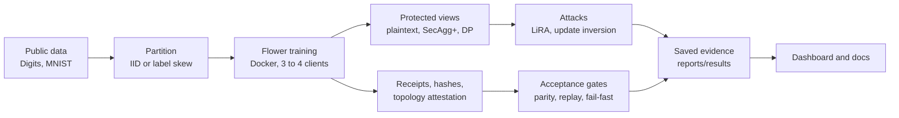

# FedDisclosure Lab

[](https://github.com/ahmedjawedaj/feddisclosure-lab/actions/workflows/ci.yml)
[](https://github.com/ahmedjawedaj/feddisclosure-lab/actions/workflows/codeql.yml)
[](LICENSE)
[](pyproject.toml)
[](#status-and-honest-limits)

**A reproducible laboratory for measuring how much a federated learning system actually discloses, and how much common defenses really help.**

FedDisclosure Lab trains real federated models with [Flower](https://flower.ai) in Docker, applies real privacy mechanisms ([Opacus](https://opacus.ai) DP-SGD, [OpenDP](https://opendp.org) releases, Flower SecAgg+), and then attacks the result with membership inference and update inversion. Every claim is tied to saved evidence, and negative results are kept next to the positive ones.

> **This is a research benchmark, not a privacy product.** It makes no formal security or privacy certification claim. Read [Status and honest limits](#status-and-honest-limits) before you cite or reuse any number.

## Why this exists

Federated learning is often described as private because raw data never leaves the client. The literature and our own measurements say that is not enough. Updates leak, secure aggregation has failure modes, and differential privacy trades away accuracy that some clients pay for more than others. This repo asks narrow, testable questions and refuses to round the answers in anyone's favor.

## What you can do with it

| Area | What is implemented | Where |
|---|---|---|
| Native federated training | Flower 1.27 Deployment Runtime in Docker Compose (SuperLink, SuperNodes, isolated client containers) on 3 and 4 clients, with per-client execution receipts and a fail-fast watchdog | `compose.flower*.yaml`, `scripts/run_flower_docker.py` |
| Secure aggregation | Upstream Flower SecAgg+ runs, a dropout matrix, an error-propagation study and a multi-round acceptance rule | `scripts/run_secagg_*`, `scripts/verify_secagg_dropout_matrix.py` |
| Differential privacy | Opacus DP-FedAvg with an RDP accountant, OpenDP counting releases with a persistent budget ledger | `src/feddisclosure/defenses/` |
| Membership inference | LiRA shadow-model attack, 64 shadows and 16 targets, on Digits and full MNIST | `scripts/run_lira_study.py` |
| Update inversion | Gradient-matching reconstruction against plaintext, SecAgg+ aggregate, n-1 collusion and DP views | `src/feddisclosure/attacks/view_study.py`, `scripts/run_view_comparison.py` |
| Determinism gates | Bitwise float32 replay of Flower aggregation and a strict float64 parity gate (kept strict even where it fails) | `scripts/reproduce_flower_bitwise.py`, `scripts/verify_flower_replay_gate.py` |
| Federated analytics | Three-site gateway with disclosure controls and a persistent principal-wide query history policy | `services/`, `src/feddisclosure/analytics/` |
| Evidence dashboard | Offline HTML explorer that reads only allowlisted scalar summaries | `dashboard/` |

Only synthetic or public data are used (scikit-learn Digits and the MNIST training split). See [`docs/data-provenance.md`](docs/data-provenance.md).

## Headline results (v0.14.3)

All numbers come from saved runs under `reports/results/`. Context and caveats are in [`docs/v0.14-privacy-secagg-results.md`](docs/v0.14-privacy-secagg-results.md). Release 0.14.3 corrects two rows of the v0.14.2 table. The old numbers are kept visible and the change is listed in [`CHANGELOG.md`](CHANGELOG.md).

**Update inversion, 4 clients, 10 seeds, 80 victim images, labels known to the attacker.** Lower error means a better reconstruction. "Recognisable" means per-image MSE below 0.05.

| Attacker view | Victim MSE | Share of images recognisable | Compared with the label-only floor |
|---|---|---|---|
| Plaintext update | 0.013 | 94% | 26 points above |
| SecAgg+ aggregate only (max weight 1000) | 0.057 | 55% | does not beat the floor |
| SecAgg+ with n-1 colluders | 0.023 | 91% | 24 points above |
| Opacus DP, sigma 0.2 (individual update, naive attacker) | 0.179 | 0% | not a protection claim |
| Label-only floor (class-average image of a public pool) | 0.046 | 67.5% | reference |
| Mean-image floor (v0.14.2 baseline, ignores labels) | 0.073 | 2.5% | too weak for this attacker |

**What the label-only floor is.** It is a prior-knowledge reference, not an attack. It rebuilds each victim record as the average image of its class, taken from a 1765-image labelled public pool (the images no client holds, against the 32 records the 4 clients hold). The inversion attack itself uses no public images. With the full pool the floor reaches 67.5% recognisable (54 of 80 images, Wilson 95% interval 57% to 77%). The floor depends on the pool size: with a pool of 20 images the floor is 31% recognisable, with 50 images 48%, with 100 images 57% and with 300 images 64%. The mean image of v0.14.2 ignores labels, which made the aggregate-only row look like leakage.

- **Plaintext and collusion.** An individual update, and an update recovered by n-1 colluders, stay clearly above the floor. These two rows still show leakage.
- **SecAgg+ aggregate only, max weight 1000.** This attack does not beat the label-only floor, on both error (0.057 against 0.046) and recognisable share (55% against 67.5%). The aggregate row is below the floor only for a pool of roughly 100 or more labelled public images. With a pool of 50 or fewer, the floor is lower than the attack on recognisable share. This attack uses no public images, so an attacker that starts from public images could do better than shown. With max weight 16 the share is 58.8% and the paired difference to the floor is -8.8 points with an interval of -23.8 to +5.0, so it cannot be told apart from the floor. This is a statement about this attack with one local step, 4 clients and 8 records each. It is not a proof that the aggregate is safe, and the v0.14.2 reading that the aggregate still leaks is withdrawn.
- **DP sigma 0.2.** Only a naive attacker was tested, one that matches gradients without modelling clipping or noise. It fails (0.179 is worse than the mean image at 0.073). That shows this attacker fails. It makes no claim about how well DP protects against anything stronger. The v0.14.2 reading that DP "stops inversion" is withdrawn.
- **Intervals.** Recognisable shares use Wilson intervals pooled over the 80 images, not t-intervals, which could leave the range 0 to 1. Both interval types are in `reports/results/privacy/v0143/view_intervals.json`.

**Membership inference (LiRA AUC, 64 shadows, 16 targets).** 0.5 is chance.

| Setting | No DP | DP, epsilon about 6 to 8 | DP, epsilon about 1.5 to 2 |
|---|---|---|---|
| Digits, overfit regime | 0.742 | 0.543 | 0.518 |
| Digits, moderate regime | 0.605 | 0.537 | 0.508 |
| MNIST, overfit regime | 0.823 | 0.575 | 0.504 |

DP at epsilon near 2 brings the attack to chance, but held-out accuracy collapses in the overfit runs (about 0.2, versus 0.84 to 0.92 without DP). An earlier 24-shadow run understated leakage at epsilon 6 to 8. The 64-shadow run corrected it and the correction is documented.

**SecAgg+ dropout.** Five mid-round dropout scenarios matched the share-count rule: four tolerated, one halted. An earlier claim that three-client dropout halts was wrong and is withdrawn in the docs.

**Determinism.** Bitwise float32 replay reproduces 7 of 7 native Flower runs. The stricter float64 reference parity gate (1e-5) passes only 5 of 7, because Flower averages float32 updates in reply order. The gate was not relaxed.

## Quick start

Requirements: Python 3.11 to 3.13. Docker Engine with Compose v2 is needed only for the native Flower runs.

```bash
git clone https://github.com/ahmedjawedaj/feddisclosure-lab.git
cd feddisclosure-lab
python -m venv .venv && source .venv/bin/activate
pip install -e '.[test,research]'

# fast test suite (234 pass and 4 skip, no Docker needed)
PYTHONPATH=src:. pytest -q -m 'not slow'

# rebuild the offline evidence dashboard
python -m dashboard.build_dashboard
```

The three-site analytics demo and the native Flower runs have their own steps. See [`docs/v0.14-reproduce.md`](docs/v0.14-reproduce.md) for the pinned versions (Flower 1.27.0, torch 2.5.1 CPU, Opacus 1.6.0, OpenDP 0.16.0) and the exact commands behind every table above.

## How an experiment is organised



A run counts as evidence only if its gates pass. Failed gates are recorded and reported, not deleted.

## Repository layout

```
src/feddisclosure/    library: analytics, attacks, defenses, federation, training, evaluation
services/             three-site analytics gateway and client services
scripts/              experiment runners, verifiers, plotting and report builders
configs/              experiment, attack and defense configurations
docker/, compose*.yaml  container images and Compose topologies
tests/                unit, integration, privacy, training and regression tests
reports/results/      saved evidence (JSON, logs, hashes, receipts)
dashboard/            offline evidence explorer
docs/                 protocols, results, threat models, decisions, provenance
```

Project status files at the repo root (`CURRENT_STATE.md`, `NEXT_SPRINT.md`, `PROJECT_CONTEXT.md`, `AGENTS.md`) record what has been verified and what remains open. The pre-public README with the full milestone history is kept in [`docs/history/README-legacy.md`](docs/history/README-legacy.md).

## Status and honest limits

- **Not a privacy product.** No differential privacy, secure aggregation or security certification is claimed. Epsilons are accountant outputs for specific runs.
- **Inversion study is an observation-model study.** The SecAgg+ view uses the upstream quantiser arithmetic on single-step updates, not captured Docker traffic. The attacker is naive and not DP-aware.
- **Multi-round SecAgg+ error.** A proof exists only for convex losses (an L2 bound, [`docs/proofs/multi-round-note.md`](docs/proofs/multi-round-note.md)). For the non-convex model used here, two-round error is bimodal because of ReLU flips, and only an empirical tolerance limit is offered. The one-round bound is proven in [`docs/proofs/one-round-secagg-error.md`](docs/proofs/one-round-secagg-error.md).
- **Scale.** Docker topologies were tested at 3 and 4 clients on a 2 CPU machine.
- **Data.** Digits and MNIST only. The MNIST originators publish no licence text, so redistribution terms are treated as unverified and the raw files are not in this repo.
- **Hosted CI.** The workflows had not run on GitHub-hosted runners before this repository was published. Their status is shown by the badges above and discussed in [`CHANGELOG.md`](CHANGELOG.md).

## Contributing

Contributions that add experiments, attackers, datasets or fixes are welcome. The one hard rule is that acceptance gates are never weakened to make a result pass and negative results are preserved. See [`CONTRIBUTING.md`](CONTRIBUTING.md) and the [Code of Conduct](CODE_OF_CONDUCT.md). Report security issues privately as described in [`SECURITY.md`](SECURITY.md).

## Citing

If you use this work, please cite it using [`CITATION.cff`](CITATION.cff) (GitHub shows a "Cite this repository" button). There is no DOI or peer-reviewed paper yet.

## License

Code is released under the [Apache License 2.0](LICENSE). Third-party data and software keep their own terms, see [`NOTICE`](NOTICE).
